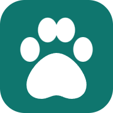
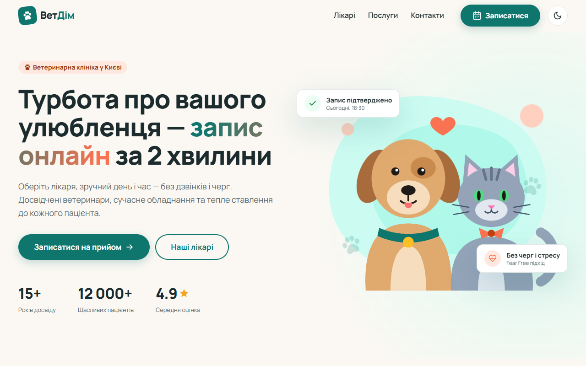
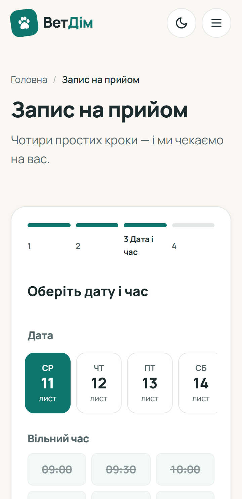
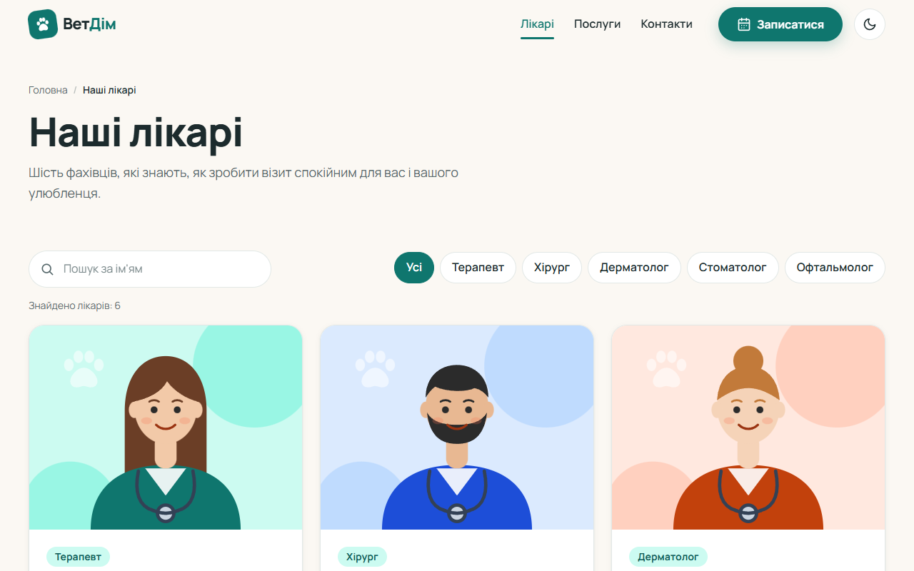
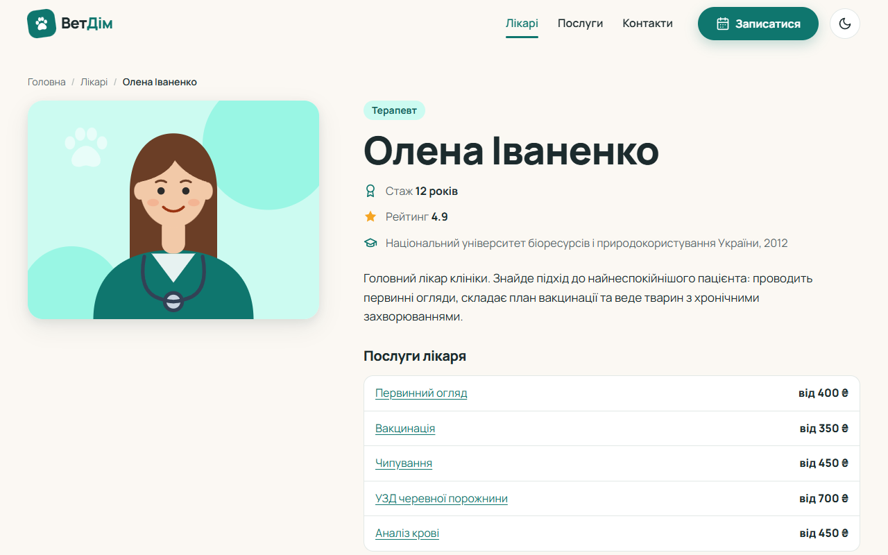
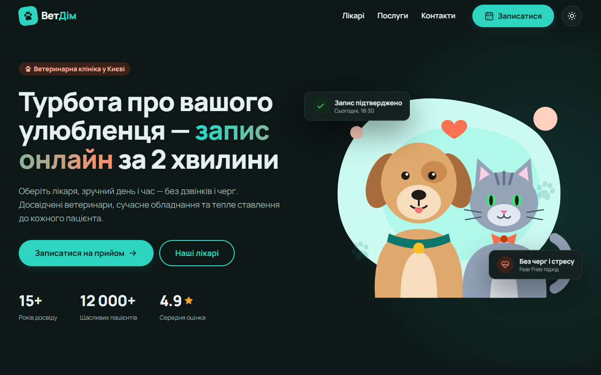
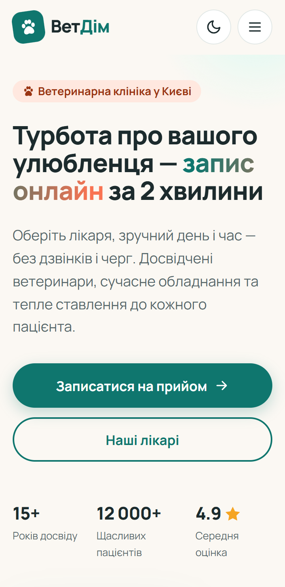
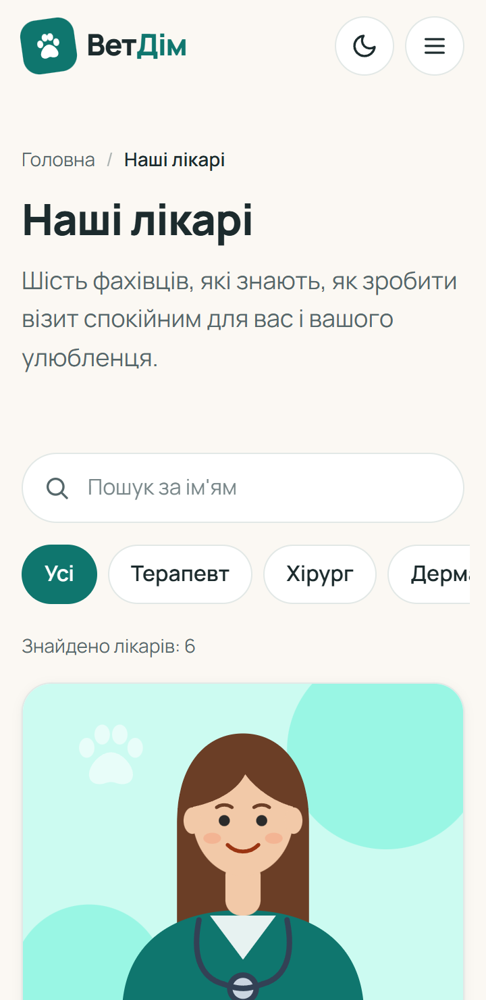
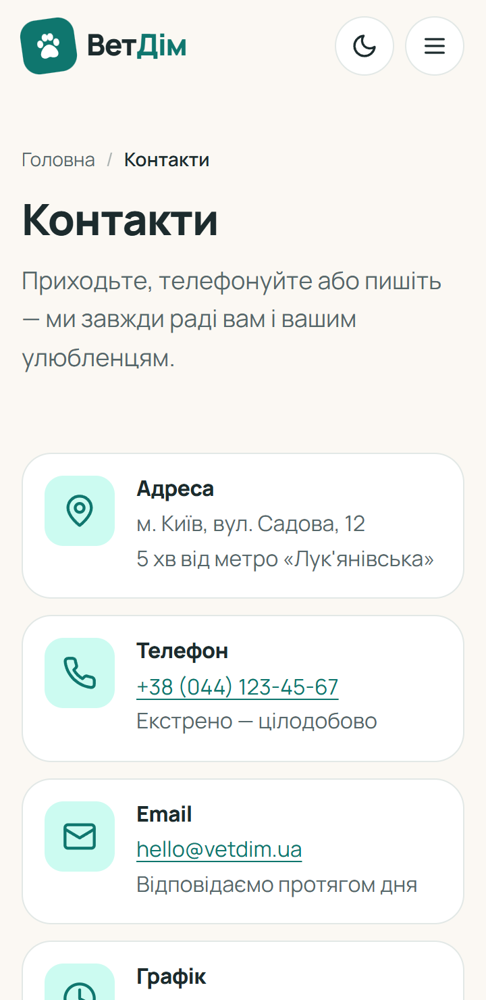
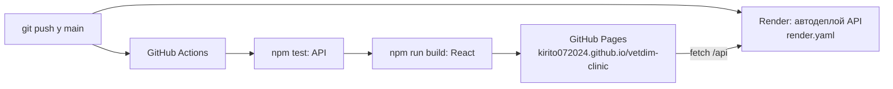

<div align="center">



# ВетДім — ветеринарна клініка

**Сайт ветеринарної клініки з онлайн-записом на прийом до обраного лікаря**

[](https://github.com/Kirito072024/vetdim-clinic/actions/workflows/deploy.yml)


🌐 **[Відкрити сайт](https://kirito072024.github.io/vetdim-clinic/)** · 📘 [Документація](#-документація) · 🧪 [Тестування](docs/TESTING.md) · 🔌 [API](docs/API.md)

<sub>Навчальна практика «WEB-технології та WEB-дизайн» · варіант 2: «Ветеринарна клініка — послуга / лікар — запис на прийом із вибором лікаря»</sub>

</div>

---

<p align="center">
  
  &nbsp;
  
</p>

## ✨ Можливості

- 🩺 **Каталог лікарів** з фільтром за спеціалізацією та миттєвим пошуком за ім'ям
- 👩‍⚕️ **Сторінка лікаря**: досвід, освіта, послуги з цінами, графік прийому
- 💉 **Каталог послуг** з категоріями, тривалістю та цінами
- 📅 **Запис у 4 кроки**: послуга → лікар → дата й вільний час → дані власника і тварини
  - показуються лише лікарі, які надають обрану послугу
  - неробочі дні та зайняті слоти недоступні, подвійне бронювання блокує сервер (409)
- ✅ **Валідація** на клієнті (під час введення) і на сервері (ті самі правила)
- 📱 **Mobile-first**: 360 / 768 / 1280 px, бургер-меню, sticky-кнопка запису
- 🌙 **Темна тема** (автоматично за налаштуваннями системи + перемикач)
- ♿ **Доступність**: семантика, клавіатура, `aria-*`, контраст WCAG AA
- 📲 **PWA**: встановлення на телефон, робота офлайн
- ⚡ **Lighthouse (mobile)**: 96–100 у всіх категоріях

## 🛠 Стек

| Шар | Технології |
|---|---|
| Проєктування | HTML-wireframe (12/4 колонки), дизайн-система на CSS-токенах |
| Фронтенд | **React 19**, **Vite 8**, React Router 7, CSS3 (custom properties, Flexbox, Grid) |
| Бекенд | **Node.js**, **Express 5**, JSON-сховище |
| Тестування | node:test (API), Puppeteer (e2e), Lighthouse, W3C Validator |
| Деплой | GitHub Actions → **GitHub Pages** (сайт), **Render** (API) |

## 📸 Скриншоти

| Каталог лікарів | Сторінка лікаря | Темна тема |
|---|---|---|
|  |  |  |

| Головна | Лікарі | Запис | Контакти |
|---|---|---|---|
|  |  |  |  |

Повні макети сторінок (desktop + mobile): [`docs/mockups/`](docs/mockups/).

## 🚀 Запуск локально

Потрібен **Node.js 20+**.

```bash
git clone https://github.com/Kirito072024/vetdim-clinic.git
cd vetdim-clinic
npm run install:all      # залежності для server/ і client/
```

У двох терміналах:

```bash
npm run dev:server       # API → http://localhost:3001/api
npm run dev:client       # сайт → http://localhost:5173
```

Vite проксіює запити `/api` на сервер, тому нічого додатково налаштовувати не треба.

| Команда | Що робить |
|---|---|
| `npm test` | 11 автотестів API |
| `npm run lint` | Перевірка коду клієнта (oxlint) |
| `npm run build` | Production-збірка в `client/dist` |

Статичну версію (ПР 4–6, чисті HTML/CSS/JS) можна відкрити будь-яким статичним сервером з папки [`static/`](static/), наприклад `npx serve static`.

## 🌐 Деплой



- **Сайт** — [`.github/workflows/deploy.yml`](.github/workflows/deploy.yml): кожен push у `main` запускає тести, лінтер, збірку та публікацію на GitHub Pages.
- **API** — [`render.yaml`](render.yaml): Render автоматично розгортає `server/` з гілки `main`.
- Адреса API передається у збірку змінною `API_URL` (GitHub → Settings → Secrets and variables → Actions → Variables). Поки її не задано, сайт працює в **демо-режимі**: дані з JSON у `client/public/data`, записи — у `localStorage` браузера.

## 📁 Структура

```
vetdim-clinic/
├── client/                 # React-версія (ПР 7–10)
│   ├── public/             # іконки, SVG, manifest, service worker, robots.txt, sitemap.xml
│   └── src/
│       ├── components/     # Header, Footer, Layout, Cards, Field, Icon, PageHero
│       ├── hooks/          # useFetch, useTheme, useDocumentMeta
│       ├── lib/            # api.js, validation.js, format.js
│       ├── pages/          # Home, Doctors, Doctor, Services, Booking, Contacts, NotFound
│       └── styles/         # tokens, base, components, layout, pages
├── server/                 # Express REST API (ПР 8)
│   ├── data/               # doctors.json, services.json (+ appointments.json під час роботи)
│   ├── src/                # app, routes, validation, schedule, db
│   └── test/               # node:test
├── static/                 # HTML/CSS/JS-версія (ПР 4–6) + styleguide.html
├── e2e/                    # сценарії Puppeteer
└── docs/                   # ТЗ, UX, дизайн-система, API, тестування, звіт
```

## 📘 Документація

| Документ | Зміст | ПР |
|---|---|:-:|
| [ASSIGNMENT.md](docs/ASSIGNMENT.md) | Завдання на практику | — |
| [TZ.md](docs/TZ.md) | Технічне завдання | 1 |
| [BACKLOG.md](docs/BACKLOG.md) | Беклог задач | 1 |
| [UX.md](docs/UX.md) | Персони, user stories, user flow, sitemap, wireframe | 2 |
| [wireframes/](docs/wireframes/index.html) | Клікабельні low-fi wireframe (desktop + mobile) | 2 |
| [DESIGN.md](docs/DESIGN.md) · [styleguide](static/styleguide.html) | Мудборд, токени, компоненти | 3 |
| [mockups/](docs/mockups/) | Макети desktop + mobile | 3 |
| [API.md](docs/API.md) | Опис REST API | 8 |
| [TESTING.md](docs/TESTING.md) · [lighthouse/](docs/lighthouse/) | Lighthouse «до/після», чек-лист, a11y, SEO | 9 |
| [AI.md](docs/AI.md) | Використання AI-інструментів | 10 |
| [DIARY.md](docs/DIARY.md) | Щоденник практики | — |
| [report.pdf](docs/report.pdf) · [presentation](docs/presentation.html) | Звіт і презентація до захисту | 10 |

Кожна практична робота позначена тегом: `pr-01` … `pr-10`.

## 🤖 AI-інструменти

Під час розробки використовувався **Claude Code** (Anthropic): генерація коду, документації та тестів, пошук помилок. Кожен фрагмент перевірено й пояснено; детально, з переліком виправлених помилок, — у [docs/AI.md](docs/AI.md).

---

<div align="center"><sub>© 2026 ВетДім · навчальний проєкт · клініка, лікарі та контакти вигадані</sub></div>
