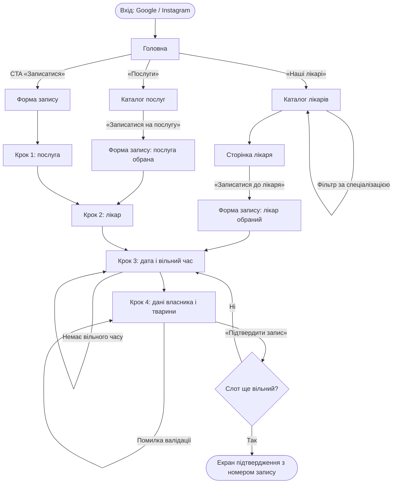
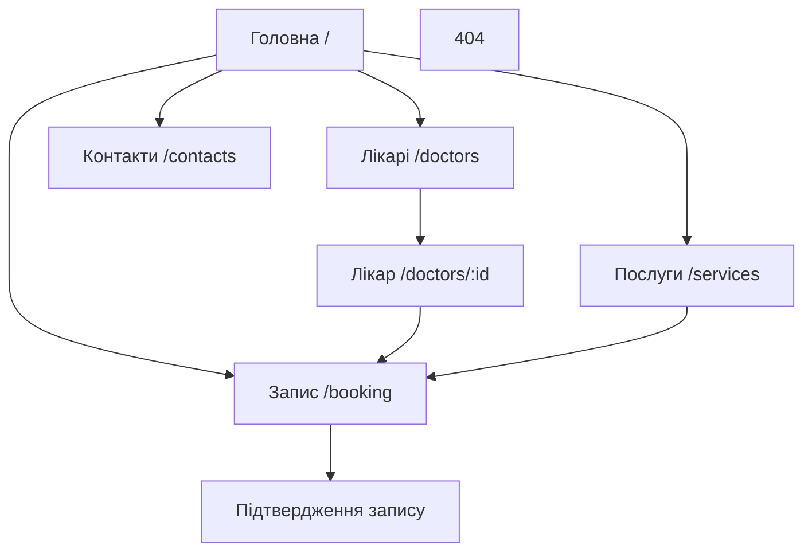

# UX-аналіз — «ВетДім»

Figma: _посилання (доступ «can view») буде додано_

## 1. Персони

### Персона 1 — Олена, 28 років
| | |
|---|---|
| Роль | Маркетологиня, власниця кота Барсика (3 роки) |
| Пристрій | Смартфон (Android, ~390 px), заходить з Instagram або Google |
| Цілі | Швидко записати кота на щеплення у зручний вечірній час, не телефонуючи |
| «Болі» | Ніколи немає часу дзвонити в робочий час; на сайтах клінік не видно вільного часу; довгі форми на телефоні незручні |
| Що їй потрібно | Запис за 1–2 хвилини, вільні слоти одразу на екрані, підтвердження з деталями |

### Персона 2 — Віктор Петрович, 58 років
| | |
|---|---|
| Роль | Інженер, власник старої вівчарки Рекса (11 років) з хронічними проблемами суглобів |
| Пристрій | Ноутбук (1366–1440 px), іноді планшет |
| Цілі | Записати пса саме до «свого» лікаря-хірурга, якому довіряє |
| «Болі» | Дрібний текст і неконтрастні кнопки; плутається в багатокрокових інтерфейсах; не розуміє, хто з лікарів що лікує |
| Що йому потрібно | Великі шрифти, зрозумілі підписи, інформація про досвід лікаря, можливість почати запис зі сторінки лікаря |

## 2. User stories

| № | User story | Пріоритет |
|---|---|---|
| US-1 | Як **власниця кота**, я хочу **бачити вільний час лікаря на обрану дату**, щоб **записатися без дзвінка в клініку**. | Високий |
| US-2 | Як **власник собаки з хронічною хворобою**, я хочу **почати запис зі сторінки конкретного лікаря**, щоб **потрапити саме до того фахівця, якому довіряю**. | Високий |
| US-3 | Як **новий клієнт**, я хочу **відфільтрувати лікарів за спеціалізацією**, щоб **швидко знайти дерматолога для свого пса**. | Середній |
| US-4 | Як **власник тварини**, я хочу **бачити перелік послуг з цінами «від»**, щоб **заздалегідь оцінити вартість візиту**. | Середній |
| US-5 | Як **користувач смартфона**, я хочу **отримати екран підтвердження з датою, часом, лікарем і номером запису**, щоб **бути впевненим, що запис створено, і мати його під рукою**. | Високий |

## 3. User flow — запис на прийом з вибором лікаря

Основний сценарій (персона Олена, мобільний). Копію в FigJam — див. посилання на Figma.

Альтернативні входи: зі сторінки лікаря (US-2) і з каталогу послуг (US-4). Ці кроки форми пропускаються, бо лікар чи послуга вже обрані.

## 4. Структура сайту (sitemap)

Глобальна навігація (хедер): Лікарі · Послуги · Контакти · кнопка «Записатися» · перемикач теми.
Футер: контакти, графік роботи, соцмережі, ті самі посилання.
